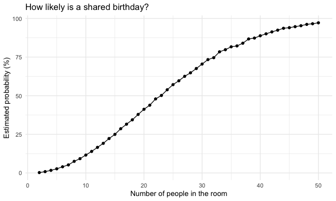

Homework 5
================
Zeheng Wei (zw3268)
2026-11-18

# Problem 1

### 1. Simulation setup

I draw each person’s birthday independently from 365 equally likely
days, so the same day can come up more than once in a room.

### 2. Simulate one room

``` r
sim_birthday = function(n) {
  birthdays = sample(1:365, n, replace = TRUE)
  n_distinct(birthdays) < n
}
```

### 3. Estimate the probability for each group size

``` r
birthday_sims =
  expand_grid(group_size = 2:50, iter = 1:10000) |>
  mutate(shared = map_lgl(group_size, sim_birthday))

birthday_prob =
  birthday_sims |>
  group_by(group_size) |>
  summarize(prob = mean(shared))
```

### 4. Plot the probability of a shared birthday

``` r
birthday_prob |>
  ggplot(aes(x = group_size, y = 100 * prob)) +
  geom_point() +
  geom_line() +
  labs(
    title = "How likely is a shared birthday?",
    x = "Number of people in the room",
    y = "Estimated probability (%)"
  )
```



### 5. Results

With 23 people, 50.2% of the simulated rooms had at least one shared
birthday. With 50 people, that rose to 97.2%. The chance rises quickly
because each new person can match anyone already in the room.

# Problem 2

### 1. List the participant files

``` r
file_df = tibble(
  files = list.files("data/hw5_data/"),
  path = str_c("data/hw5_data/", files)
)
```

### 2. Read the weekly observations

``` r
study_wide =
  file_df |>
  mutate(data = map(path, read_csv, show_col_types = FALSE)) |>
  unnest(cols = data)
```
