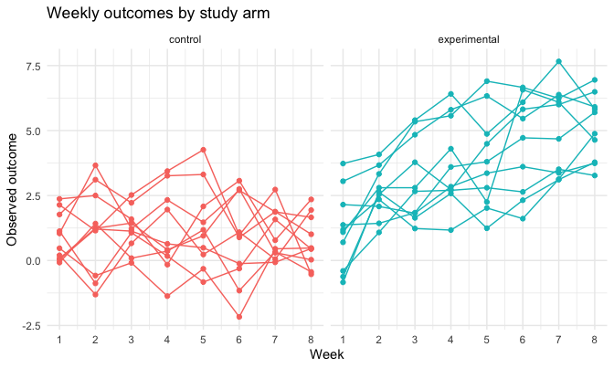
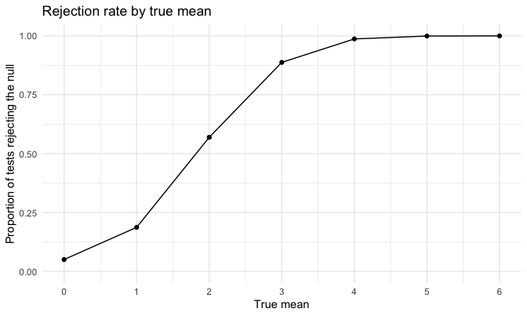
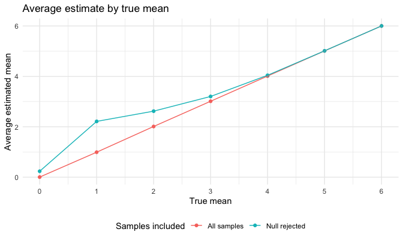

Homework 5
================
Zeheng Wei (zw3268)
2026-11-18

# Problem 1

### 1. Simulation setup

I draw each person’s birthday independently from 365 equally likely
days, so the same day can come up more than once in a room.

### 2. Simulate one room

``` r
sim_birthday = function(n) {
  birthdays = sample(1:365, n, replace = TRUE)
  n_distinct(birthdays) < n
}
```

### 3. Estimate the probability for each group size

``` r
birthday_sims =
  expand_grid(group_size = 2:50, iter = 1:10000) |>
  mutate(shared = map_lgl(group_size, sim_birthday))

birthday_prob =
  birthday_sims |>
  group_by(group_size) |>
  summarize(prob = mean(shared))
```

### 4. Plot the probability of a shared birthday

``` r
birthday_prob |>
  ggplot(aes(x = group_size, y = 100 * prob)) +
  geom_point() +
  geom_line() +
  labs(
    title = "How likely is a shared birthday?",
    x = "Number of people in the room",
    y = "Estimated probability (%)"
  )
```


### 5. Results

With 23 people, 50.2% of the simulated rooms had at least one shared
birthday. With 50 people, that rose to 97.2%. The chance rises quickly
because each new person can match anyone already in the room.

# Problem 2

### 1. List the participant files

``` r
file_df = tibble(
  files = list.files("data/hw5_data/"),
  path = str_c("data/hw5_data/", files)
)
```

### 2. Read the weekly observations

``` r
study_wide =
  file_df |>
  mutate(data = map(path, read_csv, show_col_types = FALSE)) |>
  unnest(cols = data)
```

### 3. Tidy the weekly observations

``` r
study_long =
  study_wide |>
  mutate(
    subj = str_replace(files, "\\.csv$", ""),
    arm = str_sub(subj, 1, 3),
    arm = case_when(
      arm == "con" ~ "control",
      arm == "exp" ~ "experimental"
    )
  ) |>
  pivot_longer(
    week_1:week_8,
    names_prefix = "week_",
    names_to = "week",
    values_to = "outcome"
  ) |>
  mutate(week = as.numeric(week)) |>
  select(subj, arm, week, outcome)
```

### 4. Plot each participant’s weekly outcomes

``` r
study_long |>
  ggplot(aes(x = week, y = outcome, group = subj, color = arm)) +
  geom_point() +
  geom_path() +
  facet_grid(~arm) +
  scale_x_continuous(breaks = 1:8) +
  labs(
    title = "Weekly outcomes by study arm",
    x = "Week",
    y = "Observed outcome"
  ) +
  theme(legend.position = "none")
```



### 5. Compare the study arms

In the experimental arm, all 10 participants had a higher outcome in
week 8 than in week 1, even though their values sometimes dipped along
the way. The control arm showed no clear upward trend. Four participants
finished above their starting value and six finished below it.

# Problem 3

### 1. Simulation setup

I draw 30 observations from a normal distribution with a standard
deviation of 5. The true mean ranges from 0 to 6 in steps of 1. For each
sample, I use a two-sided one-sample t-test to test whether the mean is
zero at the 0.05 significance level.

### 2. Simulate one sample and run the t-test

``` r
sim_t_test = function(true_mu) {
  x = rnorm(30, mean = true_mu, sd = 5)

  t.test(x, mu = 0) |>
    broom::tidy() |>
    select(mu_hat = estimate, p_value = p.value)
}
```

### 3. Repeat the test for each true mean

``` r
test_sims =
  expand_grid(true_mu = 0:6, iter = 1:5000) |>
  mutate(result = map(true_mu, sim_t_test)) |>
  unnest(cols = result) |>
  mutate(reject = p_value < 0.05)
```

### 4. Plot the rejection rate by true mean

``` r
power_df =
  test_sims |>
  group_by(true_mu) |>
  summarize(reject_rate = mean(reject))

power_df |>
  ggplot(aes(x = true_mu, y = reject_rate)) +
  geom_point() +
  geom_line() +
  scale_x_continuous(breaks = 0:6) +
  scale_y_continuous(limits = c(0, 1)) +
  labs(
    title = "Rejection rate by true mean",
    x = "True mean",
    y = "Proportion of tests rejecting the null"
  )
```



### 5. Describe the relationship between effect size and power

When the true mean was 0, the test rejected the null in 5% of samples,
close to the 5% Type I error rate. Power rose from 18.7% at a true mean
of 1 to 88.7% at a true mean of 3. With the same sample size and
variability, larger shifts from zero were easier to detect.

### 6. Compare estimates across all samples and significant tests

``` r
all_means =
  test_sims |>
  group_by(true_mu) |>
  summarize(avg_est = mean(mu_hat), samples = "All samples")

rejected_means =
  test_sims |>
  filter(reject) |>
  group_by(true_mu) |>
  summarize(avg_est = mean(mu_hat), samples = "Null rejected")

bind_rows(all_means, rejected_means) |>
  ggplot(aes(x = true_mu, y = avg_est, color = samples)) +
  geom_point() +
  geom_line() +
  scale_x_continuous(breaks = 0:6) +
  labs(
    title = "Average estimate by true mean",
    x = "True mean",
    y = "Average estimated mean",
    color = "Samples included"
  )
```



### 7. Explain the difference between the estimates

Across all samples, the average estimate stayed close to the true mean.
When the true mean was 1, the average was 0.99 across all samples and
2.21 among those that rejected the null. At this small positive effect,
samples with unusually high means were more likely to give a significant
result, pulling the average upward. When the true mean was 0, the
two-sided test picked up extremes in both directions, which tend to
cancel out. At larger true means, nearly all tests rejected the null, so
the two averages converged.
